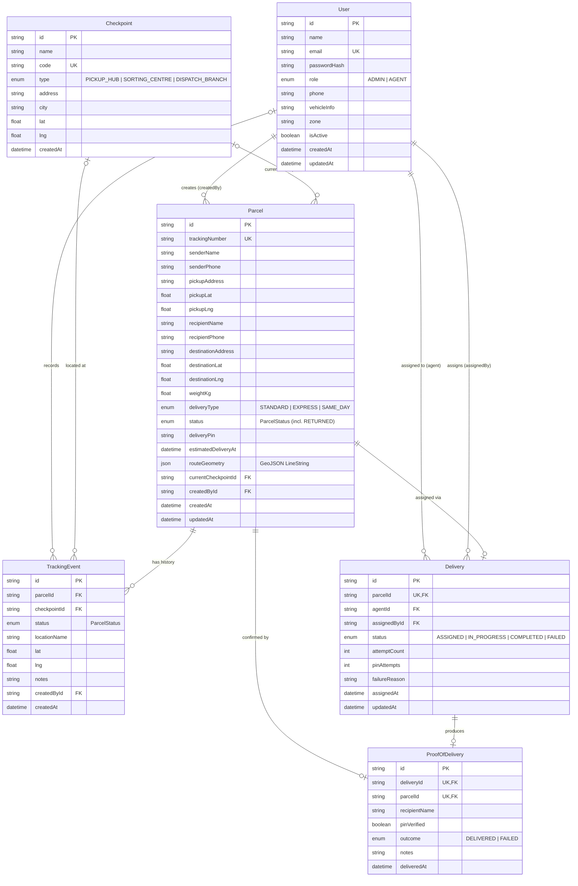

# ParcelTrack — Architecture & Data Model

## Entity-Relationship Diagram (ERD)

## Entity Responsibilities

- **`User`**: Separates authenticated `ADMIN` staff from `AGENT` couriers under one identity model so RBAC middleware can enforce permissions cleanly without duplicate auth tables.
- **`Checkpoint`**: Models physical sorting centres, pickup hubs, and dispatch branches as reusable geographic anchors rather than duplicating hub coordinates across parcels and events.
- **`Parcel`**: Acts as the central shipment aggregate holding sender/recipient metadata, current status, precomputed route geometry, and the server-generated delivery PIN.
- **`TrackingEvent`**: Provides an immutable, append-only audit trail of every status transition and checkpoint scan for customer timelines and operational accountability.
- **`Delivery`**: Decouples courier assignment, attempt counters, and PIN retry state from the parcel itself so reassignments or failed attempts never overwrite core shipment metadata.
- **`ProofOfDelivery`**: Captures an auditable completion record (`recipientName`, `pinVerified`, `deliveredAt`) only after valid PIN confirmation.

## Design Decisions

- **`TrackingEvent` as Single Source of Truth for Status:** `PATCH /api/parcels/:id` is strictly metadata-only. Every status change must flow through `POST /api/parcels/:id/events` or the `/api/deliveries/*` endpoints inside a `prisma.$transaction`, guaranteeing `Parcel.status` and `TrackingEvent` history never drift out of sync.
- **`routeGeometry` Stored as Raw GeoJSON `LineString`:** Storing a single `LineString` JSON object directly on `Parcel` avoids `FeatureCollection` wrapper boilerplate and lets MapLibre GL JS bind directly to the route source with minimal transformation.
- **`pinAttempts` Tracked on `Delivery` (Not `Parcel`):** Retry throttling belongs to the active courier delivery attempt rather than the shipment's permanent identity; if an admin reassigns a parcel, retry state resets cleanly with the assignment.
- **Seed One Parcel in Every Status:** Seeding all seven `ParcelStatus` values (`PENDING`, `PICKED_UP`, `IN_TRANSIT`, `OUT_FOR_DELIVERY`, `DELIVERED`, `FAILED_ATTEMPT`, `RETURNED`) ensures every status filter, badge color, and map state is testable from Day 1.
