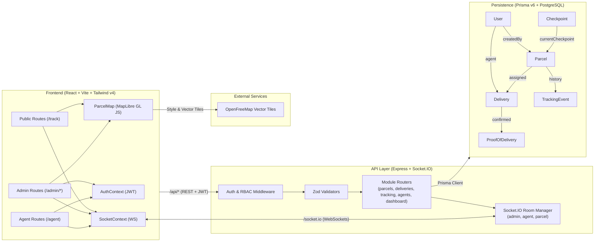

# ParcelTrack — Component Diagram

## System Component Overview

## Architectural Boundaries

The React frontend communicates exclusively with the Express REST API and Socket.IO server through the Vite dev proxy, never touching Prisma or PostgreSQL directly so that all authentication, role-based access control, and Zod validation remain strictly server-enforced. Socket.IO shares the same Node.js HTTP server as Express, allowing REST controllers to emit room-scoped real-time events (`admin`, `agent:<id>`, `parcel:<trackingNumber>`) immediately after Prisma transactions commit. OpenFreeMap is the sole external runtime dependency, supplying free OpenStreetMap-based vector tiles directly to `ParcelMap` without API keys or paid mapping services.
