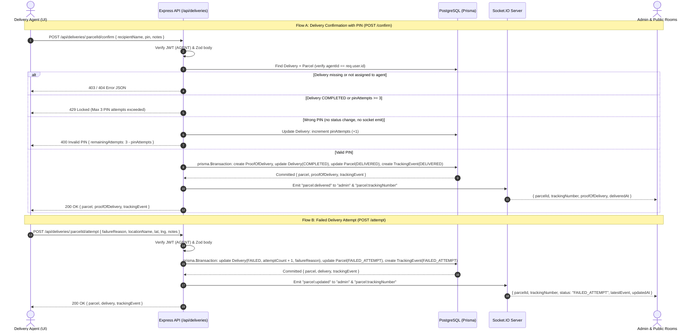
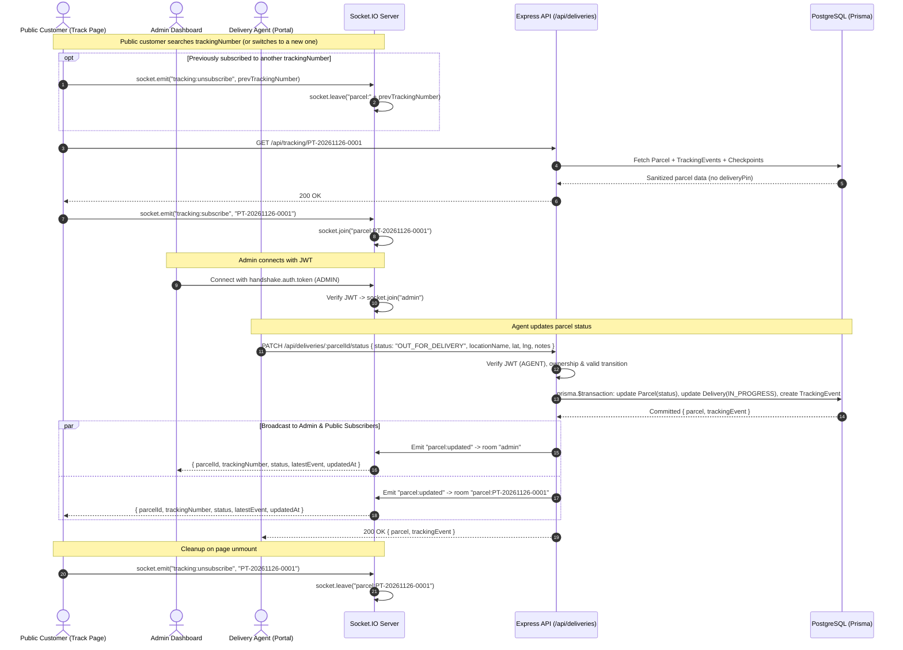
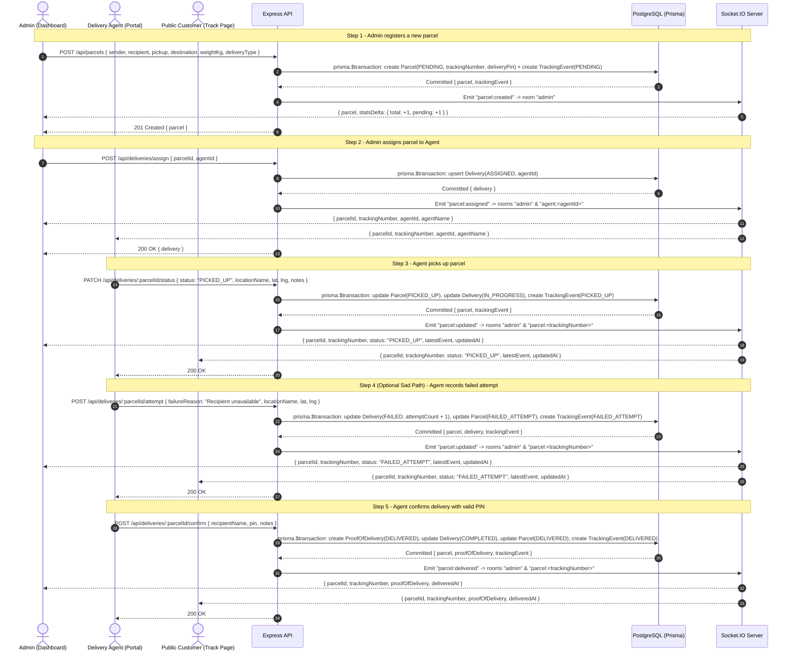

# ParcelTrack — Sequence Diagrams

## 1. Delivery Confirmation (`POST /confirm`) & Failed Attempt (`POST /attempt`)

**Design Rationale:**
PIN verification in `POST /confirm` is capped at 3 attempts to mirror production OTP rate-limiting and prevent brute-force guessing, rejecting wrong PINs without mutating parcel status or broadcasting false tracking events. A real-world failed delivery (e.g., recipient unavailable) is separated into `POST /attempt`, which atomically updates `Delivery`, `Parcel`, and `TrackingEvent` and notifies both the admin and customer in real time.

---

## 2. Real-Time Live Tracking

**Design Rationale:**
Room-scoped Socket.IO broadcasts (`admin` and `parcel:<trackingNumber>`) ensure customers only receive updates for the shipment they are actively viewing while admins receive fleet-wide updates. Symmetric `tracking:subscribe` and `tracking:unsubscribe` calls prevent room accumulation and duplicate UI updates when a user searches multiple tracking numbers in one session.

---

## 3. Full Parcel Lifecycle (Master Demo Flow)

**Design Rationale:**
Every database write that alters shipment state (`parcel:created`, `parcel:assigned`, `parcel:updated`, `parcel:delivered`) executes inside a Prisma transaction and emits its corresponding Socket.IO event only after commit. This guarantees connected clients never render optimistic or stale state if a database write fails.
